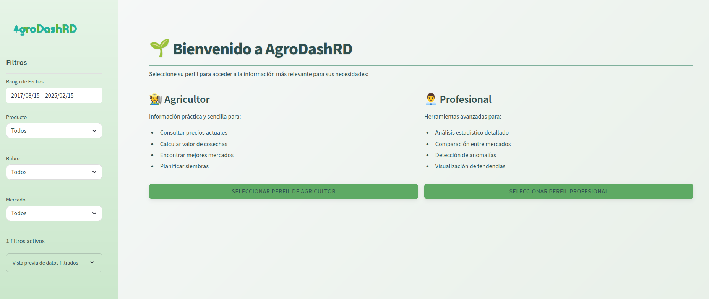

# AgroDashRD - Dominican Agricultural Sector Analysis Dashboard 🌱



## What is AgroDashRD?

AgroDashRD is a comprehensive platform for visualizing and analyzing agricultural sector data in the Dominican Republic. It is being rebuilt as a single Python application: a mobile-first **Streamlit** web app on top of a clean data pipeline and validated price forecasts.

## Architecture

One Python package, `src/agrodash`, organized by feature. Business logic does not depend on the UI, so the Streamlit layer can be replaced later without touching it.

```
src/agrodash/
  catalog/      products, name aliases, units, markets
  prices/       prices, field reports and validation
  ingestion/    Google Drive and upload sources, parsers, normalizers, quarantine
  forecasting/  backtesting, models, batch job, stored predictions
  accounts/     users, roles, password hashing, login lockout
  infra/        settings, database, migrations
  web/          Streamlit pages (presentation only)
```

The migration runs in phases (F0 to F6); progress is tracked in [odd/tasks/agrodash-python-platform.md](odd/tasks/agrodash-python-platform.md). The FastAPI backend, the empty Flutter app and the original Streamlit app (`legacy/`) were removed; the old app can still be read in git history (`git show 75c584b:legacy/app.py`).

## Features

### For Farmers 👨‍🌾
- **Current Prices**: Check real-time market prices.
- **Harvest Calculator**: Estimate harvest value.
- **Best Markets**: Find the most profitable markets.

### For Professionals 📊
- **Value Chain Analysis**: Track product flow.
- **Price Forecasts**: next-month price with an 80% and 95% range, checked every run against statistical and machine-learning models.
- **Statistical Analysis**: In-depth metrics.

## Getting Started

### Prerequisites
- [uv](https://docs.astral.sh/uv/) (installs Python 3.12 automatically)
- Docker & Docker Compose (optional): `docker compose up -d db` starts a local PostgreSQL after you set `POSTGRES_PASSWORD` in `.env`

### Development

```bash
uv sync                 # create .venv and install dependencies
cp .env.example .env    # adjust settings if needed
uv run alembic upgrade head   # create or upgrade the database schema
uv run agrodash create-admin --email you@example.com --superadmin   # first account
uv run agrodash ingest --drive   # load the official price history from Google Drive
uv run agrodash forecast         # forecast every series ready to forecast
uv run agrodash web              # web app on http://localhost:8501
uv run pytest           # run the test suite
uv run ruff check .     # lint
uv run ruff format .    # format
```

### Configuration

Settings are read from `AGRODASH_*` environment variables or `.env` (see [.env.example](.env.example)):

| Variable | Default | Notes |
|---|---|---|
| `AGRODASH_ENV` | `development` | `development` or `production` |
| `AGRODASH_DATABASE_URL` | `sqlite:///agrodash.db` | Production refuses to start on SQLite |
| `AGRODASH_DRIVE_FILE_IDS` | the official wholesale and retail reports | Comma-separated ids of Drive files shared with "Anyone with the link" |

### Loading price data

`agrodash ingest` loads the official wholesale and retail price reports (`.csv`, `.xlsx` or `.xls`, in the ministry's layouts), either from files (`agrodash ingest mayorista.xlsx minorista.xls`) or from Google Drive (`agrodash ingest --drive`).

- Spelling variants of product names, rubros, units and week words are normalized. New products and name aliases are drafted automatically and stay unreviewed until an admin confirms them.
- Prices are converted to a base unit (pound, unit or liter). A series (product, market, wholesale or retail, base unit) never mixes base units; a product that changes how it is sold for at least four weeks (pepino retail moved from the pound to the piece in 2024) starts a new series, while a stray unit label is quarantined.
- The reports' own mistakes are repaired where the intent is clear: an unreadable date between two rows that agree takes their date, an "ñ" exported as ";" is restored, Excel error cells count as missing values, and a damaged type column does not reject a sound row. A name listed twice in a row in the same week is two products the report does not tell apart (Berenjena Pompadur, Plátano Macho x Hembra); the second becomes "… (fila 2)" for an admin to name.
- Rows that cannot be trusted are kept in quarantine with a reason instead of being loaded: unreadable date or price, unit without a size, unit that does not match its series, or a second price for the same week. `N/D`, blank and `0` cells are missing values, not errors.
- `agrodash quality-report` summarizes the data: rejections by reason, unreviewed name aliases, products that look renamed between reports (for an admin to confirm), and which series are ready to forecast (at least 104 weeks, 75% of weeks 1-4 covered, a price in the last 8 weeks). `--series-csv FILE` exports every series with its coverage.
- Technicians report field prices; they stay pending until an admin validates them, and reports more than 50% away from the recent official median are flagged.
- `agrodash forecast` forecasts the next four report periods of every series ready to forecast. The forecast is the last price, with 80% and 95% ranges from how the series moved over the last year (in backtests they held about 82% and 93% of later prices); a backtest on the official history showed that one month ahead nothing beat the last price (selecting AutoETS, Theta or gradient boosting per series was worse on unseen periods). Each run re-measures those models against it and stores the scores, so a change would show. `--skip-benchmark` runs in seconds instead of minutes. Series that are not ready get no forecast ("sin pronóstico").
- Loading the same file again does nothing. Another export of the same report (for example the `.csv` of an `.xlsx`) only adds prices that are not stored yet. A failed load is recorded with its error and can be retried.

Reading prices and forecasts needs no account. Accounts exist for people who report prices (TECNICO), manage data (ADMIN) or own the platform (SUPERADMIN). Passwords are hashed with Argon2id, and five failed logins lock an account for 15 minutes.

Schema changes go through Alembic migrations in `src/agrodash/infra/migrations`: after editing a model, run `uv run alembic revision --autogenerate -m "<change>"` and review the generated file. Tests run every schema test on SQLite, and also on PostgreSQL when `AGRODASH_TEST_POSTGRES_URL` is set (CI does this).

## Documentation

- **[INFORME_AUDITORIA.md](INFORME_AUDITORIA.md)**: Audit report.
- Deployment and configuration guides are rewritten in phase F6; the current ones still describe the FastAPI + Flutter design.

## Support

For questions, please open an issue or contact the development team.

---
Developed with ❤️ for the Dominican agricultural sector.
